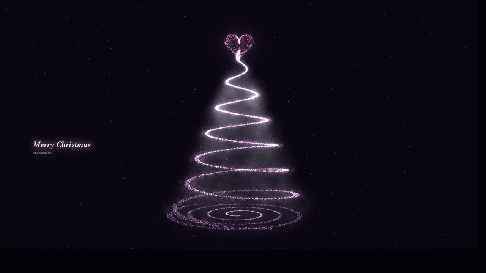

# 电子圣诞树 · Merry Christmas

一棵用粒子螺旋盘成的电子圣诞树：纯黑星空、木槿粉 + 浅茄紫的螺旋光带、树尖一颗粒子心、贴地摊开的光池，加飘雪与零星烟花。

**在线观看：** https://jameswang0722.github.io/xmas-tree/



- 单文件、零依赖，打开 `index.html` 即可运行
- 自适应铺满任意屏幕（手机竖屏 / 桌面横屏都做了构图适配）
- 开场约 3 秒：粒子自上方螺旋汇聚成树，随后无限循环
- 点击 / 触摸屏幕任意位置会额外炸开一朵烟花

## 想改点什么

所有可调项都在 `index.html` 顶部的三个常量里，改完刷新即可：

| 常量 | 作用 |
| --- | --- |
| `PAL` | 配色。`hib` 木槿粉、`aub` 浅茄紫、`heart` 树尖的心、`gold`/`jade` 烟花 |
| `CFG` | `turns` 螺旋圈数、`spin` 自转速度、`breathe` 呼吸幅度、`intro` 开场时长、`fireMin/fireMax` 烟花间隔 |
| `TEXT` | 左侧两行文案 |

预览定格某一帧：在地址后加 `?t=5`，就会停在第 5 秒，方便截图。

## 本地运行

直接双击 `index.html` 就能看。想用本地服务器：

```bash
npx serve .
```

## 说明

- 画面由 Canvas 2D 实时绘制，没有视频文件、没有外部资源，离线可用
- 分辨率按设备像素比自适应，最多按 2 倍渲染以保证性能
- 帧率过低时会自动降低粒子数量（只降一次）

Merry Christmas · have a good day 🎄
